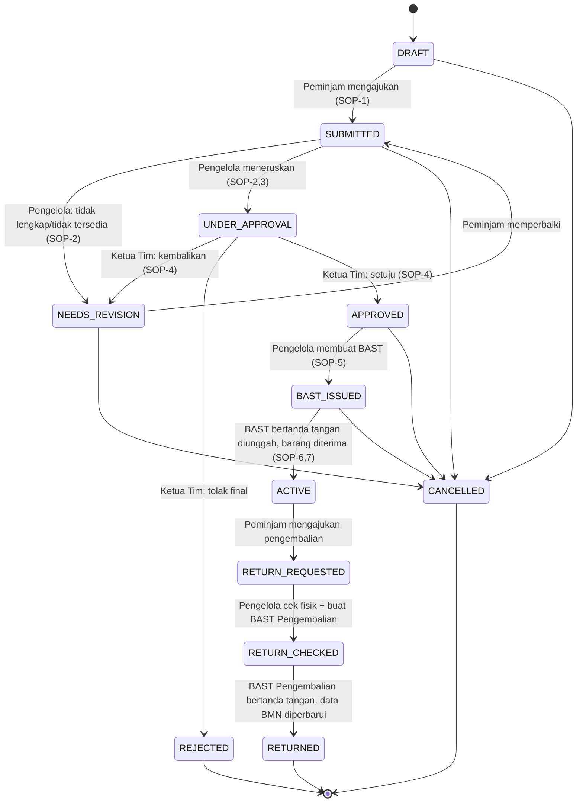

# Alur SOP → State Machine

Sumber: `Draft_WF_SOP_Peminjaman_dan_Pengembalian_BMN.docx` (gambar flowchart ada di `docs/reference/sop-peminjaman-flowchart.png` dan `sop-pengembalian-flowchart.png`). Nomor SOP: B-489/BBLSDM.73/OT.02.02/09/2025, tanggal 08/09/2025, versi 1.0, disahkan Kepala BBLSDM.

## 1. SOP Peminjaman BMN (aktor: Peminjam · Pengelola BMN · Ketua Tim Keuangan dan Aset)

| No | Aktivitas | Aktor | Syarat | Waktu | Output |
|---|---|---|---|---|---|
| 1 | Mengajukan peminjaman dengan mengisi form dan memberikan form ke petugas | Peminjam | Form Pengajuan Peminjaman | 5 menit | — |
| 2 | Menerima dan menelaah form, cek ketersediaan dan kondisi BMN. **Keputusan: dokumen lengkap?** Jika tidak, kembali ke Peminjam | Pengelola BMN | Dokumen telah diisi lengkap | 10 menit | Form Pengajuan |
| 3 | Meneruskan dokumen ke PIC Keuangan dan Aset | Pengelola BMN | Form Pengajuan | 1 menit | Form Pengajuan yang telah ditelaah |
| 4 | Menelaah dan memberi persetujuan. **Keputusan: setuju?** Jika tidak, kembali ke Peminjam | Ketua Tim Keuangan dan Aset | Form yang telah ditelaah | 5 menit | Keputusan |
| 5 | Membuat BAST Peminjaman | Pengelola BMN | Disposisi Ketua Tim Aset | 5 menit | Draft BAST |
| 6 | Menandatangani BAST dan dokumentasi | Peminjam | Draft BAST | 5 menit | BAST Peminjaman dan dokumentasi BMN |
| 7 | Menerima BMN | Peminjam | — | 1 menit | — |

Kualifikasi pelaksana: mampu mengoperasikan komputer; mampu administrasi terkait BMN. Peralatan: komputer, printer/scanner/mesin fotokopi, jaringan internet. Pencatatan: disimpan sebagai dokumen elektronik. Peringatan: jika SOP tidak dilaksanakan, mengganggu proses pencatatan BMN.

> **Catatan temuan pada draft SOP:** kolom waktu langkah 1–7 berjumlah 5+10+1+5+5+5+1 = **32 menit**, sedangkan baris "Jumlah Waktu" tertulis **28 menit**. Sarankan ke pemilik SOP untuk dikoreksi. Aplikasi memakai nilai per langkah (bukan total) sebagai target SLA yang bisa diubah di pengaturan.

## 2. SOP Pengembalian BMN (aktor: Pegawai · Petugas BMN)

| No | Aktivitas | Aktor | Syarat | Waktu | Output |
|---|---|---|---|---|---|
| 1 | Mengajukan pengembalian | Pegawai | Fisik BMN | 1 menit | Fisik BMN |
| 2 | Cek kesesuaian jumlah, jenis, dan kondisi BMN | Petugas BMN | Fisik BMN telah berada di kantor | 5 menit | Hasil pengecekan |
| 3 | Membuat BAST Pengembalian | Petugas BMN | Hasil pengecekan | 1 menit | Draft BAST Pengembalian |
| 4 | Menandatangani BAST Pengembalian dan dokumentasi | Pegawai | Draft BAST | 1 menit | BAST yang telah ditandatangani + dokumentasi |
| 5 | Update pencatatan pemakaian barang dan data BMN | Petugas BMN | BAST yang telah ditandatangani | 1 menit | — |
| 6 | Menyimpan BMN yang telah dikembalikan | Petugas BMN | — | 1 menit | — |

Total 10 menit (cocok dengan jumlah di SOP).

## 3. State machine pengajuan (`loan_requests.status`)

`OVERDUE` bukan status tersimpan: dihitung dari `status = ACTIVE|RETURN_REQUESTED` dan `end_date < hari ini (WITA)`.

## 4. Tabel transisi (implementasi di `src/lib/loan-state-machine.ts`)

| Dari | Ke | Aktor yang berhak | Guard (harus benar) | Efek samping |
|---|---|---|---|---|
| DRAFT | SUBMITTED | PEMINJAM (pemilik) | ≥1 barang; periode valid; tidak bentrok (BR-02) | Catat waktu ajukan; **tahan barang** untuk periode itu (`is_blocking`); notifikasi ke PENGELOLA_BMN |
| SUBMITTED | NEEDS_REVISION | PENGELOLA_BMN | Catatan wajib; bukan pemohon sendiri | Lepas penahanan barang; notifikasi ke peminjam |
| SUBMITTED | UNDER_APPROVAL | PENGELOLA_BMN | Checklist lengkap/tersedia/kondisi baik (BR-03) | Notifikasi ke KETUA_TIM_ASET |
| UNDER_APPROVAL | APPROVED | KETUA_TIM_ASET | Bukan pemohon sendiri (BR-08) | **Terbitkan Surat Peminjaman bernomor** (BR-06); notifikasi ke PENGELOLA_BMN |
| UNDER_APPROVAL | NEEDS_REVISION / REJECTED | KETUA_TIM_ASET | Alasan wajib | Lepas penahanan barang; notifikasi ke peminjam |
| APPROVED | BAST_ISSUED | PENGELOLA_BMN | Penandatangan aktif tersedia | **Terbitkan BAST Peminjaman bernomor** |
| BAST_ISSUED | ACTIVE | PENGELOLA_BMN | File BAST bertanda tangan terunggah | Barang → `ON_LOAN`; catat kondisi keluar |
| ACTIVE | RETURN_REQUESTED | PEMINJAM / PENGELOLA_BMN | — | Notifikasi ke PENGELOLA_BMN |
| RETURN_REQUESTED | RETURN_CHECKED | PENGELOLA_BMN | Kondisi tiap barang terisi; tindak lanjut wajib jika rusak/hilang (BR-10) | **Terbitkan BAST Pengembalian bernomor** |
| RETURN_CHECKED | RETURNED | PENGELOLA_BMN | File BAST Pengembalian bertanda tangan terunggah | Barang → `AVAILABLE` atau `NEEDS_FOLLOW_UP`; tutup peminjaman |
| (pra-ACTIVE) | CANCELLED | Pemilik atau PENGELOLA_BMN | Belum ACTIVE | Lepas penahanan barang; nomor yang sudah terbit ditandai `VOID`, tidak dipakai ulang |

Setiap transisi: tulis `loan_status_history` (dari, ke, aktor, catatan, waktu) dan `audit_logs`.

## 5. Penempatan penerbitan dokumen (asumsi — lihat OPEN_QUESTIONS Q4)

| Dokumen | Pratinjau tanpa nomor | Nomor diterbitkan saat |
|---|---|---|
| Surat Peminjaman | Saat pengajuan (SUBMITTED) | APPROVED (karena ditandatangani Ketua Tim) |
| BAST Peminjaman | — | BAST_ISSUED |
| BAST Pengembalian | — | RETURN_CHECKED |

## 6. SLA

Waktu per langkah di tabel SOP dipakai sebagai **target waktu proses aktif**, bukan batas keras. Dashboard Pengelola menampilkan penanda "melewati target" bila pengajuan berada di satu status lebih lama dari batas yang bisa diatur (default: 1 hari kerja per tahap) karena target 5–10 menit hanya masuk akal untuk waktu kerja efektif, bukan waktu tunggu.
